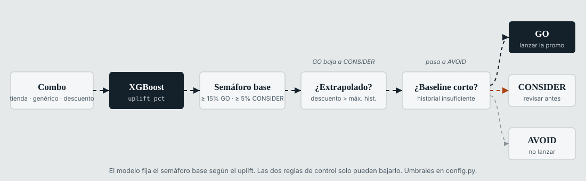

# promo-uplift-ml

[English](README.md)

Pipeline de machine learning que estima el **uplift en unidades vendidas** de una promoción para cada combinación tienda × producto de una cadena de retail deportivo. Para un nivel de descuento y una mecánica promocional, predice cuántas unidades más vende el combo con la promoción que sin ella y lo traduce en una recomendación GO / CONSIDER / AVOID.

| | |
|---|---|
| Modelo | XGBoost y LightGBM; el champion se elige con un scorecard de negocio (BLS) |
| Plataforma | AWS SageMaker Pipelines, S3, ETL en pandas |
| Consumo | Tablas Snowflake cargadas por DataOps, vista de recomendaciones y simulador en Power BI |
| Estado | MVP en producción, scoring semanal |

Código de producción de un proyecto de consultoría. Se eliminaron identificadores del cliente, nombres de infraestructura, datos, modelos entrenados y documentos internos. El pipeline completo corre con cualquier dataset del mismo esquema.

## Arquitectura


| Pipeline | Pasos | Programación |
|---|---|---|
| `promo-uplift-etl` | Parquet crudo de SAP a dataset de features (19 CTEs, particiones mensuales en caché) | Bajo demanda |
| `promo-uplift-training` | 1-4 | Bajo demanda; se dispara solo tras el ETL y ante un dry run fallido |
| `promo-uplift-scoring` | 5-9 | Semanal, lunes 02:00 CST; se dispara solo tras el training |

El pipeline no escribe en Snowflake. Deja Parquet en `publish/` y un proceso DataOps aparte ejecuta el `MERGE` sobre `PROMO_PREDICTIONS` y `PROMO_ELASTICITY_CURVES`. El I/O de contenedores por paso está en [deploy/README.md](deploy/README.md).

## Estructura del repositorio

```
.
├── config.py              Parámetros y rutas centrales (local o SageMaker vía variables SM_*)
├── requirements.txt       Dependencias de ejecución (contenedores SageMaker)
├── requirements-dev.txt   Desarrollo local: notebooks, EDA, apps Streamlit, SDK SageMaker
├── .env.example           Plantilla de variables de entorno
├── src/                   Pasos del pipeline (un script por paso) y módulo de features
├── deploy/                Definición de pipelines SageMaker, empaquetado y ejecución local
│   └── ETL/               promo-uplift-etl: genera el dataset de features desde SAP
├── notebooks/             Versión notebook de src/, generada con scripts/convert_to_notebooks.py
├── scripts/               Apps Streamlit, empaquetado, conversión a notebooks, diagramas
│   └── debug/             Scripts de diagnóstico (fuera del pipeline)
├── docs/images/           Diagramas del README, generados con scripts/build_diagrams.py
├── data/                  Dataset de entrada (no versionado)
├── models/                Artefactos del modelo (no versionados)
├── reports/               Salidas del pipeline (no versionadas)
└── dist/                  Paquetes de deploy (no versionados)
```

## Instalación

Requiere Python 3.11.

```bash
python -m venv .venv
.venv\Scripts\activate          # Windows
source .venv/bin/activate       # Linux / macOS

pip install -r requirements-dev.txt
cp .env.example .env            # buckets, ARN del rol de SageMaker, región AWS
```

Copiar el dataset en `data/train-set-features.csv` (salida de `deploy/ETL`) y ejecutar los pasos 1-2 para generar `models/`.

## Pasos del pipeline

| # | Script | Salida | Función |
|---|---|---|---|
| 1 | `src/tune.py` | `models/tune_meta.json` | Búsqueda bayesiana de hiperparámetros (Optuna TPE) para LightGBM y XGBoost |
| 2 | `src/train.py` | `models/*.pkl`, `train_meta.json` | Entrena ambos modelos; el BLS scorecard elige el champion |
| 3 | `src/cv.py` | `reports/cv/cv_report.json` | Validación cruzada temporal con gap de 28 días; gate de calidad (WMAPE ≤ 25%) |
| 4 | `src/explain.py` | `reports/shap/` | Importancia SHAP global y gráficos de dependencia |
| 5 | `src/elasticity.py` | `reports/elasticity/` | Curvas de uplift por tienda × producto × mecánica × descuento (0-50%, 9 puntos) |
| 6 | `src/score.py` | `reports/scoring/scoring_output.csv` | Uplift, confianza y recomendación por combo |
| 7 | `src/staging.py` | `staging_output.parquet` | Validaciones bloqueantes, margen incremental y ROI, esquema Snowflake |
| 8 | `src/dryrun.py` | `dryrun_report.json` | 12 checks entre artefactos; define `dry_run_approved` |
| 9 | `src/publish.py` | `reports/publish/` | Copia las salidas a `publish/` solo si el dry run fue aprobado |


`src/features.py` no es un paso: es el módulo compartido (`build_features()`, `FEATURE_COLS`, `CAT_COLS`) que importan todos los pasos. `src/eda_perfilamiento.py` es un script independiente de perfilamiento de datos.

### Ejecución local

```bash
python deploy/run_local.py                         # pasos 1-9
python deploy/run_local.py --pipeline scoring      # pasos 5-9
python deploy/run_local.py --from-step 6           # desde score.py
```

Cada paso también corre por separado, por ejemplo `python src/tune.py --n-trials 50` o `python src/score.py --active-window-days 180`. Todos los scripts aceptan `--help`.

### Deploy en SageMaker

```bash
python deploy/deploy_sm.py           # empaqueta src/ + config.py y sube a S3
python deploy/pipeline_def.py        # registra o actualiza ambos pipelines
python deploy/deploy_sm.py --run     # lanza una ejecución

python deploy/ETL/deploy.py --run --fecha-inicio 20260101 --fecha-fin 20260301   # ETL
```

Requiere `PROMO_S3_BUCKET` y `SAGEMAKER_ROLE_ARN` en el entorno.

## Granularidad de inferencia

| Etapa | Granularidad | Rol de la fecha |
|---|---|---|
| Entrenamiento | tienda × producto × día | Codificada en lags, estadísticas rolling y features de calendario |
| Scoring | tienda × producto | Ninguno. Una recomendación por combo a partir de su último snapshot de features |

`scoring_date` indica cuándo corrió el pipeline, no un horizonte de predicción.

## Reglas del semáforo



| Condición | Resultado |
|---|---|
| `uplift_pct ≥ 15%`, descuento dentro del rango histórico, baseline suficiente | GO |
| `5% ≤ uplift_pct < 15%`, o `≥ 15%` con descuento extrapolado | CONSIDER |
| `uplift_pct < 5%`, o baseline insuficiente | AVOID |

Umbrales en `config.py` (`UPLIFT_GO`, `UPLIFT_CONSIDER`); se ajustan con `--go-threshold` y `--consider-threshold`.

## Modelo vigente

Modelo champion XGBoost (`xgb_base.pkl`), definido en `CHAMPION_MODEL` de `config.py`.

| Métrica | Validación (desde 01/12/2025) | CV temporal | Objetivo |
|---|---|---|---|
| WMAPE | 8.4% | 12.3% | ≤ 12% (gate ≤ 25%) |
| Bias | -4.5% | -11.7% | ±5% objetivo, ±10% máximo |
| Lift accuracy | 89.2% | 85.0% | ≥ 85% objetivo, ≥ 70% mínimo |
| R² | 0.58 | - | ≥ 0.75 objetivo, ≥ 0.60 mínimo |
| BLS | 1.85 (LightGBM 0.87) | - | Gana el mayor |

WMAPE CV por división: calzado 11.5%, textil 12.8%, accesorios 14.1%. Último dry run: 12/12 checks aprobados, 886 combos evaluados (63 GO, 117 CONSIDER, 706 AVOID).

BLS (business lift score) = `lift_accuracy × (1 − |bias| / 0.15) / (WMAPE / 0.25)`.

## Limitaciones conocidas

| # | Punto | Estado |
|---|---|---|
| 1 | La última corrida de tuning usó 1 trial; el objetivo de producción es 50 por algoritmo | Pendiente |
| 2 | La última CV usó 1 fold; el default es 5 | Pendiente |
| 3 | Bias CV (-11.7%) fuera del límite de ±10%; R² de validación (0.58) bajo el mínimo de 0.60 | En revisión |
| 4 | `score.py`, `dryrun.py` y `train.py` mantienen un fallback `lgbm_tuned.pkl` que ya no se genera | Limpieza pendiente |
| 5 | Mecánicas con < 5% de registros dan resultados orientativos | Acumulando historial |

## Roadmap

| Punto | Dependencia |
|---|---|
| Gate de stock y regla GO completa (`confidence ≥ 0.7 AND margin_roi > 1 AND stock OK`) | Snapshot nocturno de MARD (SAP) |
| Componentes de confianza: varianza CV por combo y detección fuera de distribución | Reentrenamiento con logging |
| Champion/challenger mensual con gate BLS | - |
| `price_elasticity_coeff` log-log en la tabla de curvas | - |
| Vista semanal agregada de predicciones para Power BI | - |

## Diagramas

Los diagramas se generan, no se editan a mano:

```bash
python scripts/build_diagrams.py
```

## Licencia

[MIT](LICENSE)
