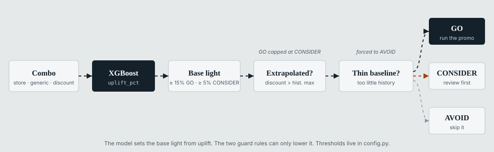

# promo-uplift-ml

[Español](README.es.md)

Machine learning pipeline that estimates the **sales uplift** of a promotion for each store × product combination of a sports retail chain. Given a discount level and a promotional mechanic, it predicts how many more units the combo sells with the promotion than without it, and turns that into a GO / CONSIDER / AVOID recommendation.

| | |
|---|---|
| Model | XGBoost and LightGBM, champion picked by a business scorecard (BLS) |
| Platform | AWS SageMaker Pipelines, S3, Athena-style ETL in pandas |
| Consumers | Snowflake tables loaded by DataOps, Power BI recommendations view and scenario simulator |
| Status | MVP in production, weekly scoring |

This is production code from a consulting engagement. Client identifiers, infrastructure names, data, trained models and internal documents have been removed. The pipeline runs end to end on any dataset with the same schema.

## Architecture


| Pipeline | Steps | Schedule |
|---|---|---|
| `promo-uplift-etl` | Raw SAP Parquet to feature set (19 CTEs, cached monthly partitions) | On demand |
| `promo-uplift-training` | 1-4 | On demand; triggered automatically by the ETL and by a failed dry run |
| `promo-uplift-scoring` | 5-9 | Weekly, Monday 02:00 CST; triggered automatically after training |

The pipeline never writes to Snowflake. It writes Parquet to `publish/`, and a separate DataOps process runs the `MERGE` into `PROMO_PREDICTIONS` and `PROMO_ELASTICITY_CURVES`. Container I/O per step is documented in [deploy/README.md](deploy/README.md).

## Repository layout

```
.
├── config.py              Central parameters and paths (local or SageMaker via SM_* env vars)
├── requirements.txt       Runtime dependencies (installed in SageMaker containers)
├── requirements-dev.txt   Local development: notebooks, EDA, Streamlit apps, SageMaker SDK
├── .env.example           Environment variable template
├── src/                   Pipeline steps (one script per step) and the shared feature module
├── deploy/                SageMaker pipeline definitions, packaging and local runner
│   └── ETL/               promo-uplift-etl: builds the feature set from raw SAP data
├── notebooks/             Notebook versions of src/, generated by scripts/convert_to_notebooks.py
├── scripts/               Streamlit apps, packaging, notebook conversion, diagram builder
│   └── debug/             Diagnostic scripts (not part of the pipeline)
├── docs/images/           README diagrams, generated by scripts/build_diagrams.py
├── data/                  Input dataset (not versioned)
├── models/                Model artifacts (not versioned)
├── reports/               Pipeline outputs (not versioned)
└── dist/                  Deploy packages (not versioned)
```

## Setup

Requires Python 3.11.

```bash
python -m venv .venv
.venv\Scripts\activate          # Windows
source .venv/bin/activate       # Linux / macOS

pip install -r requirements-dev.txt
cp .env.example .env            # bucket names, SageMaker role ARN, AWS region
```

Place the feature set at `data/train-set-features.csv` (produced by `deploy/ETL`) and run steps 1-2 to build `models/`.

## Pipeline steps

| # | Script | Output | Purpose |
|---|---|---|---|
| 1 | `src/tune.py` | `models/tune_meta.json` | Bayesian hyperparameter search (Optuna TPE) for LightGBM and XGBoost |
| 2 | `src/train.py` | `models/*.pkl`, `train_meta.json` | Trains both models; the BLS scorecard picks the champion |
| 3 | `src/cv.py` | `reports/cv/cv_report.json` | Time-series cross-validation with a 28-day gap; quality gate (WMAPE ≤ 25%) |
| 4 | `src/explain.py` | `reports/shap/` | Global SHAP importance and dependence plots |
| 5 | `src/elasticity.py` | `reports/elasticity/` | Uplift curves per store × product × mechanic × discount (0-50%, 9 points) |
| 6 | `src/score.py` | `reports/scoring/scoring_output.csv` | Uplift, confidence and recommendation per combo |
| 7 | `src/staging.py` | `staging_output.parquet` | Blocking validations, incremental margin and ROI, Snowflake schema |
| 8 | `src/dryrun.py` | `dryrun_report.json` | 12 cross-artifact checks; sets `dry_run_approved` |
| 9 | `src/publish.py` | `reports/publish/` | Copies outputs to `publish/` only if the dry run passed |


`src/features.py` is not a step. It is the shared module (`build_features()`, `FEATURE_COLS`, `CAT_COLS`) imported by every step. `src/eda_perfilamiento.py` is a standalone data profiling script.

### Run locally

```bash
python deploy/run_local.py                         # steps 1-9
python deploy/run_local.py --pipeline scoring      # steps 5-9
python deploy/run_local.py --from-step 6           # from score.py onward
```

Each step also runs on its own, for example `python src/tune.py --n-trials 50` or `python src/score.py --active-window-days 180`. Every script supports `--help`.

### Deploy to SageMaker

```bash
python deploy/deploy_sm.py           # package src/ + config.py and upload to S3
python deploy/pipeline_def.py        # register or update both pipelines
python deploy/deploy_sm.py --run     # start an execution

python deploy/ETL/deploy.py --run --fecha-inicio 20260101 --fecha-fin 20260301   # ETL
```

Requires `PROMO_S3_BUCKET` and `SAGEMAKER_ROLE_ARN` in the environment.

## Inference grain

| Stage | Grain | Role of the date |
|---|---|---|
| Training | store × product × day | Encoded in lags, rolling statistics and calendar features |
| Scoring | store × product | None. One recommendation per combo from its latest feature snapshot |

`scoring_date` records when the pipeline ran. It is not a forecast horizon.

## Recommendation rules



| Condition | Result |
|---|---|
| `uplift_pct ≥ 15%`, discount within historical range, sufficient baseline | GO |
| `5% ≤ uplift_pct < 15%`, or `≥ 15%` with an extrapolated discount | CONSIDER |
| `uplift_pct < 5%`, or insufficient baseline | AVOID |

Thresholds live in `config.py` (`UPLIFT_GO`, `UPLIFT_CONSIDER`) and can be overridden with `--go-threshold` and `--consider-threshold`.

## Current model

The champion model is XGBoost (`xgb_base.pkl`), set by `CHAMPION_MODEL` in `config.py`.

| Metric | Validation (from 2025-12-01) | Time-series CV | Target |
|---|---|---|---|
| WMAPE | 8.4% | 12.3% | ≤ 12% (gate ≤ 25%) |
| Bias | -4.5% | -11.7% | ±5% target, ±10% max |
| Lift accuracy | 89.2% | 85.0% | ≥ 85% target, ≥ 70% min |
| R² | 0.58 | - | ≥ 0.75 target, ≥ 0.60 min |
| BLS | 1.85 (LightGBM 0.87) | - | Higher wins |

CV WMAPE by division: footwear 11.5%, apparel 12.8%, accessories 14.1%. Last dry run: 12/12 checks passed, 886 combos scored (63 GO, 117 CONSIDER, 706 AVOID).

BLS (business lift score) = `lift_accuracy × (1 − |bias| / 0.15) / (WMAPE / 0.25)`.

## Known limitations

| # | Item | Status |
|---|---|---|
| 1 | Latest tuning run used 1 trial; production target is 50 trials per algorithm | Pending |
| 2 | Latest CV run used 1 fold; the default is 5 | Pending |
| 3 | CV bias (-11.7%) exceeds the ±10% limit; validation R² (0.58) is below the 0.60 minimum | Under review |
| 4 | `score.py`, `dryrun.py` and `train.py` keep a `lgbm_tuned.pkl` fallback that is no longer produced | Cleanup pending |
| 5 | Mechanics with < 5% of records give indicative results only | Accumulating history |

## Roadmap

| Item | Dependency |
|---|---|
| Stock gate and full GO rule (`confidence ≥ 0.7 AND margin_roi > 1 AND stock OK`) | SAP MARD nightly snapshot |
| Confidence components: CV variance per combo and out-of-distribution detection | Retraining with logging |
| Monthly champion/challenger with BLS gate | - |
| Log-log `price_elasticity_coeff` in the curves table | - |
| Weekly aggregated predictions view for Power BI | - |

## Diagrams

Diagrams are generated, not hand-edited:

```bash
python scripts/build_diagrams.py
```

Code comments and console output are in Spanish.
